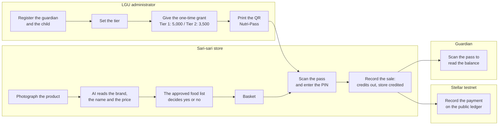

<div align="center">

  

</div>

<br />

## Team Information

**Team Name:**
JUMBO HOTDOG

**Project Name:**
BANTAYOG

---

## Project Brief

> **food credits should be usable where people already shop—not only where payment infrastructure exists.**

**Food credits address a real nutrition need.**  
Low-income families may struggle to afford a varied, nutritious diet, putting children and other vulnerable household members at risk of poor nutrition. Food-credit programs help by giving eligible households purchasing power for approved food items instead of unrestricted cash. Their aim is to improve access to food and support healthier diets. **But food credits only help when families can actually redeem them.**

**The government already has a solution—but access can still be a last-mile problem.**  
The Philippines' [DSWD Walang Gutom Program](https://www.dswd.gov.ph/dswds-walang-gutom-program-identifies-beneficiaries-based-on-psas-family-income-and-expenditure-survey-updated-cbms-database/) already provides eligible households with ₱3,000 in monthly food credits through Electronic Benefit Transfer (EBT) cards, redeemable at accredited retailers. This is not a new idea, nor does BANTAYOG replace that program.

The challenge we target is **access to a nearby redemption point**. The [DSWD implementation guidelines](https://old.dswd.gov.ph/issuances/MCs/MC_2024-019.pdf) explicitly recognize limited markets in geographically isolated areas, call for retailer-access assessments in underserved communities, and provide alternative food-distribution arrangements. Small businesses, including sari-sari stores (tiny neighborhood shops, often run from a family's home), can participate in government programs; the issue is not that they are categorically excluded. Rather, a neighborhood store that is not onboarded as an authorized redemption partner cannot accept that program's food credits. For some households, that may mean travel to a participating outlet or reliance on scheduled food distribution. The size of this access gap still needs local field research.

**What BANTAYOG proposes**  
BANTAYOG is a **smartphone-based food-credit redemption and accountability system for neighborhood sari-sari stores**, designed to reduce dependence on dedicated point-of-sale (POS) hardware. A participating store uses its phone to scan food items and a printed QR **Nutri-Pass**; the guardian needs no smartphone. Server rules check which items are eligible, record the purchase, and track credits. Stellar testnet provides ledger proof. AI assists with item recognition and settlement review, while PayPal sandbox invoicing lets the program confirm a store claim's payment status.

The current prototype issues **its own demonstration credits** for a child-and-guardian program. It **does not accept existing DSWD EBT balances** or connect to DSWD systems. Stores must still be approved by the program operator. Its PayPal sandbox setup also does not yet prove direct payment to each individual store.

**The intended users or beneficiaries**

- Infants &amp; guardians in the First 1,000 Days cohort (the current prototype)
- Low-income households that could benefit from locally redeemable food assistance
- LGUs (Local Government Units) and aid organizations running food-credit programs
- Approved neighborhood sari-sari store merchants
- Funders, including local programs and international aid groups. No agency partnership is claimed.

**The intended impact**  
BANTAYOG aims to bring food-credit redemption closer to where beneficiaries live and shop, while giving program operators item-level purchase records and payment-status proof. Whether it reduces travel, onboarding costs, or settlement time—and whether it improves diets or health—must be tested in the field; these are goals, not measured outcomes.

**Beyond the Philippines**
BANTAYOG is built for the Philippines. The same model can fit other places where small neighborhood shops sell daily food and aid arrives as restricted credits. We have not tested it outside the Philippines.

## PayPal and AI: the new payment flow

**Check each basket. Review the claim. Verify the payment.**

Why PayPal: a sponsor can use PayPal Checkout to fund the program. The server checks PayPal's capture record before that net contribution can back a new grant.

**Rule: No captured PayPal money, no grant.**

1. A funder contributes at `/fund`. The server captures an approved Orders v2 order.
   The receipt and `/admin/fund` show gross, fee, and net separately.
2. The administrator triggers a grant. The database checks net completed PayPal captures.
   Only acquired reservations permit Stellar credit issuance. Without captured funds, the grant is refused.
3. The merchant scans eligible food items at the counter. AI assists with product recognition;
   server rules decide food eligibility.
4. The merchant requests payment for confirmed, unpaid sales.
5. Server price rules hold unusual prices. Gemini writes the review summary and can add a hold
   when a price reference is missing. It cannot change an amount or release a server hold.
6. A program officer checks each sale and its ledger proof, releases a hold if appropriate, and
   approves. The server creates and sends the PayPal invoice.
7. The funder pays the program's invoice in PayPal. BANTAYOG checks the remote invoice and shows paid only for `PAID`.

The store needs no PayPal account. PayPal records the payment to the program.
The program must then pay the store through a separate local transfer.

**Current limits:** one sandbox business account receives every store invoice. This does not
prove payment to a separate store account. Store payout on the local rail is separate and is not
proved by a paid invoice. All new grants are backed by net completed PayPal contributions; legacy
demonstration grants do not reduce the available pool. Successful funded grant tests use a fake
chain client; this environment has not run a successful funded Stellar grant. All
PayPal payments use test funds. No live payment is supported.

The model proposes, server rules fix the amounts, a person approves, and PayPal executes.
The database prevents one sale from being claimed twice and one capture from being recorded twice.
SQL reservations prevent new grants from reserving more than the net captured pool.

Use the [server setup](apps/server/README.md), [build contracts](docs/designs/paypal-settlement.md),
[fund contract](docs/designs/paypal-fund.md), and [verification record](docs/paypal-hackathon/verification.md).
Event rules and the submission checklist stay in [the event folder](docs/paypal-hackathon/).

---

## Team Members


| Name                   | Role                   |
| ---------------------- | ---------------------- |
| Bennett P. Payoyo      | Developer / Researcher |
| Alex L. Berin Jr.      | Developer / Researcher |
| Anjoe Mikael T. Albano | Developer / Researcher |
| Tyrone Loius V. Teemer | Developer / Researcher |


---

## Why This Problem Is Hard

The target program serves the First 1,000 Days cohort. It needs proof at the food counter as
well as a record of disbursement. The prototype addresses three gaps:


| Failure mode          | What happens today                                                                                                         | What BANTAYOG does instead                                                                                |
| --------------------- | -------------------------------------------------------------------------------------------------------------------------- | --------------------------------------------------------------------------------------------------------- |
| **Purchase control** | A cash grant can pay for many needs. The transfer alone does not prove a food purchase. | Credits are checked against the approved food list at checkout. |
| **Item proof** | A disbursement record does not contain the store basket. | The sale record contains the items, amount, time and ledger reference. |
| **Payment proof** | A store with daily cash needs cannot sell on an unpaid promise. A recorded sale does not by itself prove that the store claim was paid. | The officer reviews the claim, then PayPal supplies invoice payment status. |


Two design constraints shaped everything else:

- **The guardian has no smartphone budget and can have low literacy.** The guardian interface is
therefore a printed piece of paper. There is no app to install and no account to remember.
- **Sari-sari stores have weak data connections.** The store app therefore installs on the phone, and each sale

    completes the moment the merchant confirms it.

---

## How BANTAYOG Works



### The five steps, in order

1. **Registration.** The administrator records the guardian and the child. The record holds the
 monthly income, the home location, and a 6-digit guardian PIN. The system keeps the PIN in a
 one-way protected form. Nobody can read the PIN again, not even an administrator.
2. **Tier.** The system puts each child in one of two tiers. Tier 1 is the critical tier. It
 applies while the age from conception is 1,000 days or less. This equals 730 days or less from
 birth. Tier 2 is the standard tier. It applies after that day. The system sets the tier again on
 each read, again at each scan, and one time each night. A child cannot stay in the critical tier
 after the child is too old for it.
3. **Grant.** Each child gets one grant only. Tier 1 gets 5,000 credits. Tier 2 gets 3,500
 credits. One credit is one peso. The tier gives the amount. No device and no user can ask for a
 different amount, and the system refuses a second grant for the same child. Every new grant is
 backed by net completed PayPal captures; without sufficient captured funding, the system refuses
 the grant. An unresolved reservation blocks simultaneous and repeated attempts until operator review.
4. **Purchase.** The merchant photographs the product. The AI reads the brand and the product
 name. It also gives a suitability result for a small child and a price estimate. The approved
 food list then makes the eligibility decision. The AI never makes that decision. The merchant
 scans the pass, and the guardian types the PIN. The system makes six checks in a fixed order:
 the pass signature, the pass validity, the status of the child, the PIN, a total above zero, and
 sufficient credits. After five wrong PIN entries the system locks the pass for 15 minutes.
5. **Settlement.** The system removes the credits from the pass, adds the same amount to the store
 balance, and writes the receipt. These three actions occur together, or none of them occurs. The
 merchant sees the result immediately. The ledger record follows the sale. The PayPal claim and
 invoice payment are separate steps; recording credits does not mean that a PayPal invoice is paid.

### Safeguards we built on purpose


| Safeguard                        | How the system holds it                                                                                                                       |
| -------------------------------- | --------------------------------------------------------------------------------------------------------------------------------------------- |
| One path for money               | Every peso moves through one protected step in the database. That step locks the record, checks the balance, and writes the receipt together. |
| Exact money                      | Pesos keep two decimal places. Credits are whole numbers. One credit is one peso. No rounding error can occur.                                |
| Fund-backed grants               | New grants require net completed PayPal captures. A database advisory lock checks available net funds before reservation. All failures retain funding until operator review. |
| A double tap cannot pay twice    | Each checkout carries one unique key. A repeated tap with the same key collides, and the system pays one time only.                           |
| One invoice claim per sale | A database constraint reserves each released sale for one settlement invoice. |
| The AI cannot approve a sale     | The approved food list is the only authority for eligibility. The AI only identifies the product.                                             |
| The device decides nothing       | The server sets the tier, the grant, the eligibility, and the balance. The app only shows the result.                                         |
| A negative balance is impossible | The database refuses a balance below zero, and it refuses any grant amount other than 5,000 or 3,500.                                         |


---

## Who Uses BANTAYOG

One system serves three groups. Each group sees its own screens only. A store device cannot open
the LGU portal, and the guardian page shows information only.


| User                   | What the user does                                                                                            | How the user signs in                             |
| ---------------------- | ------------------------------------------------------------------------------------------------------------- | ------------------------------------------------- |
| **LGU administrator**  | Registers a guardian and a child, sets the tier, releases the grant, and prints the Nutri-Pass                | Email and password, with an administrator role    |
| **Sari-sari merchant** | Scans a product, fills the basket, completes the checkout, reads the sales history, and moves the balance out | Mobile number and password, or a wallet signature |
| **Guardian**           | Reads the current balance and the recent purchases                                                            | No account. The printed pass is the key           |


---

## What Is Built

- **LGU portal.** Guardian and child registration, tier computation, the one-time grant, and
printed Nutri-Pass issue.
- **Store app.** AI product scan, branded and palengke baskets, guardian PIN with lockout,
checkout, and the sales history.
- **Merchant balance view.** The merchant sees their live on-chain PHPC balance, read directly
from the Stellar network; there is no cash-out or wallet-connect step.
- **Guardian balance page.** The current balance plus the 50 most recent purchases, read-only.
- **Public ledger record.** PHPC credits on the Stellar network, plus a nightly tier re-check.
- **Android mobile app of the store surface.** The merchant frontend installs on the phone as an
Android app.

---

## Tech Stack


| Layer                          | What we use                                                                                                                                    | Why it matters here                                                                                                                                                                          |
| ------------------------------ | ---------------------------------------------------------------------------------------------------------------------------------------------- | -------------------------------------------------------------------------------------------------------------------------------------------------------------------------------------------- |
| **AI at the counter**          | Google Gemini multimodal vision                                                                                                                | One photo returns the brand, the product name, a child-suitability verdict with flagged ingredients, a food group, and a peso price band. Gemini identifies; the approved food list decides. |
| **Store and portal UI**        | Next.js 16 (App Router), React 19, TypeScript 5.7, Tailwind CSS 4, Zustand 5, TanStack Query 5 and Table 8, react-hook-form                    | One codebase serves the LGU portal, the store counter, and the guardian balance page, each on its own sandboxed surface.                                                                     |
| **Merchant frontend delivery** | Capacitor 8 Android shell over the same web codebase                                                                                           | The merchant surface ships as an installable Android mobile app, built for low-end phones at the store counter.                                                                              |
| **Camera, QR and printing**    | Browser camera APIs, html5-qrcode and ZXing, react-qr-code, html-to-image                                                                      | Product photos and pass scans need no native plugin, and a Nutri-Pass prints straight from the browser.                                                                                      |
| **API and business rules**     | Hono 4 on Node, Zod 4 at every boundary, neverthrow result types, pino structured logs, XState lifecycle model                                 | Every request is parsed before it is trusted, and every expected failure is a typed value with a stable status code.                                                                         |
| **Data**                       | Supabase Postgres, pgvector image embeddings, pg_trgm fuzzy matching, append-only migrations, row-level security                               | The database itself holds the money rules: one guarded settlement step, a row lock, and constraints that make a bad row impossible.                                                          |
| **Abuse control**              | Upstash Redis sliding windows                                                                                                                  | Guardian PIN lockout and per-endpoint limits on login, scanning, and checkout.                                                                                                               |
| **Blockchain**                 | Stellar testnet, classic Stellar asset (PHPC), native Fee Bump transactions, @stellar/stellar-sdk 16 (No Soroban smart contracts) | A zero-fee public settlement record for every peso. We use native Stellar payments and Fee Bumps to sponsor user fees, avoiding costly smart contracts entirely. |
| **Cryptography**               | Argon2id guardian PINs, signed JWS pass tokens, AES-256-GCM key storage                                                                        | The paper pass is a real credential, and no secret is ever readable at rest.                                                                                                                 |
| **Monorepo and quality gate**  | pnpm 9 workspace, Turborepo 2, Vitest 2, fast-check property tests, DTO snapshot contracts                                                     | Lint with zero warnings, a full type-check, and the test suite gate every change.                                                                                                            |


---

## Getting Started

**Prerequisites:** Node ≥ 20, pnpm 9.15.0 (pinned — do not use npm or yarn), a Supabase project,
an Upstash Redis database, a Gemini API key, and Stellar testnet accounts (created by the
bootstrap script below; no manual setup needed beyond internet access to Horizon testnet).

```bash
# 1. install
pnpm install

# 2. environment — copy each example and fill it in
cp .env.example .env                          # Supabase, Upstash, Gemini, chain vars
cp apps/server/.env.example apps/server/.env
cp apps/web/.env.example apps/web/.env.local

# 3. database — follow docs/paypal-hackathon/setup.md for a new or existing project

# 4. Stellar asset bootstrap (issues PHPC, sets issuer flags, funds distribution)
pnpm bootstrap:stellar                        # idempotent; safe to re-run after a testnet reset

# 5. run — web on :3000, API on :3001
pnpm dev
```

Use [the local setup guide](docs/paypal-hackathon/setup.md) for the guarded fresh-install SQL
file. Do not replay an applied migration. PayPal needs migrations `00018` and `00019` and the server
settings in [the setup guide](apps/server/README.md). Use your own sandbox accounts and keys.
For payment tests against existing confirmed test sales, Stellar keys are not required. Keep
`RECONCILE_INTERVAL_MS=0` in that local environment so it cannot drain a live outbox.

Quality gate and per-package commands:

```bash
pnpm lint            # eslint, --max-warnings 0
pnpm type-check      # tsc --noEmit across the graph
pnpm test            # vitest in every package

pnpm --filter @bantayog/server test
pnpm --filter @bantayog/web test
```

---

## Competitions &amp; Showcases

### SparkFest 2026 — 1st Runner-Up

BANTAYOG was built for **SparkFest 2026**, the flagship hackathon organized by the **Google
Developer Groups on Campus – Polytechnic University of the Philippines (GDG on Campus PUP)**. The
team placed **1st Runner-Up** on July 9, 2026.

---

## Repository Information

- **License:** [MIT](LICENSE), matching the existing package license.

- **Live Demo:** [Watch Demo](https://drive.google.com/file/d/1HbexEd2dmRrOxbiT5l1bJY4QRoW5PWiQ/view?usp=drive_link)
- **APK Download:** [Download APK](https://drive.google.com/drive/folders/1WBwtM_48NqHBRsulMHh0qs_ClyvFr24N?usp=sharing)
- **Test Credentials (So you can login and test our project):** [Testing_Access](https://drive.google.com/file/d/1D7TcflxdrH6FG4aDZIQkJAVpAizVpaKg/view?usp=sharing) 

