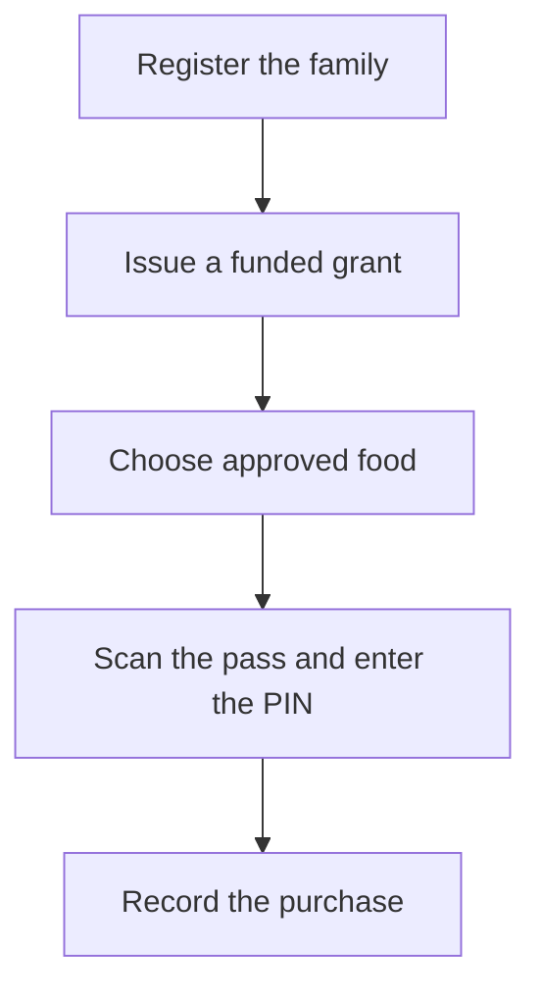

<div align="center">


# BANTAYOG

**Helping the families put their children’s nutrition first.**

A food-credit system that lets families buy approved food at local stores with a printed QR pass. Stores use a phone, AI helps review payment requests, and PayPal sandbox handles funding and invoices.

[](LICENSE)
[](#paypal-and-ai)
[](#tech-stack)

[Why BANTAYOG](#why-bantayog) · [How it works](#how-it-works) · [PayPal and AI](#paypal-and-ai) · [Quick Start](#quick-start) · [Tech Stack](#tech-stack) · [Demo and APK](#demo-and-downloads)

</div>

<br>

## Why BANTAYOG?

### Food credits address a nutrition need

&emsp;&emsp;Low-income families may struggle to afford a varied, nutritious diet, putting children and other vulnerable household members at risk of poor nutrition.
Food-credit programs give eligible households purchasing power for approved food instead of unrestricted cash, with the aim of improving food access and diets.
That support can reach families only when they can actually redeem the credits.

### Access to a nearby redemption point

&emsp;&emsp;The Philippines'
[DSWD Walang Gutom Program](https://www.dswd.gov.ph/dswds-walang-gutom-program-identifies-beneficiaries-based-on-psas-family-income-and-expenditure-survey-updated-cbms-database/)
already provides eligible households with **₱3,000 in monthly food credits** through Electronic Benefit Transfer (EBT) cards, redeemable at accredited retailers.
BANTAYOG does not replace this program, but focuses on **access to a nearby redemption point**.

&emsp;&emsp;The [DSWD implementation guidelines](https://old.dswd.gov.ph/issuances/MCs/MC_2024-019.pdf) recognize limited markets in geographically isolated areas
and call for retailer-access assessments in underserved communities, with alternative food-distribution arrangements.
Small businesses, including sari-sari stores, can participate in government programs, but a store must be an authorized partner before accepting that program's credits.
For some households, a nearby store that is not an authorized partner may mean travel to a participating outlet or reliance on scheduled food distribution.
The size of this access gap still needs local field research.

### What BANTAYOG proposes

&emsp;&emsp;BANTAYOG proposes a **smartphone-based food-credit redemption and accountability system for neighborhood sari-sari stores** to reduce dependence on dedicated point-of-sale hardware.
A participating merchant uses a phone to scan food items and a printed QR **Nutri-Pass**, so the guardian does not need a smartphone.
The server checks which items are eligible while recording purchases and tracking credits.
AI assists with item recognition and settlement review, while Stellar testnet provides ledger proof and PayPal sandbox invoicing confirms a store claim's payment status.

&emsp;&emsp;The prototype issues **its own demonstration credits** for a child-and-guardian program and requires stores to be approved by the program operator.
It does not accept existing DSWD EBT balances or connect to DSWD systems, and its PayPal sandbox setup does not prove direct payment to each store.

### Who it is for

- Infants and guardians in the **First 1,000 Days** cohort, which the current prototype serves.
- Low-income households that could benefit from locally redeemable food assistance.
- Local Government Units (LGUs) and aid organizations running food-credit programs.
- Approved neighborhood sari-sari store merchants.
- Funders, including local programs and international aid groups. No agency partnership is claimed.

### The intended impact

&emsp;&emsp;BANTAYOG aims to bring food-credit redemption closer to where beneficiaries live and shop, while giving operators item-level purchase records and payment-status proof.
Whether it reduces travel, onboarding costs, or settlement time, or improves diets and health, still needs field testing.
These are goals rather than measured outcomes.

<br>

## How it works

<div align="center">



</div>

1. **Register the family.** An administrator records the guardian and child, sets a 6-digit
   guardian PIN, and prints their signed QR Nutri-Pass.
2. **Issue a funded grant.** Each child gets one age-based grant of **5,000 credits for Tier 1**
   or **3,500 for Tier 2**, backed by verified PayPal contributions after fees.
   **One credit is one peso.**
3. **Choose approved food.** The merchant photographs products or selects fresh food such as rice
   and vegetables. Gemini helps identify products, but the approved catalog decides eligibility.
4. **Confirm the purchase.** The merchant scans the pass, and the guardian enters the PIN.
   The server checks the pass, PIN, beneficiary status, total, and available credits before checkout.
   Five wrong PIN entries cause a 15-minute lockout.
5. **Record the purchase.** The database updates both balances and saves the receipt in one
   transaction. The guardian can then check the new balance without waiting for the Stellar testnet record.

For example, an approved **₱120 basket uses 120 credits** and creates a ₱120 sale record for the
store. Because payment follows a separate flow, recording the sale does not mean the store has received cash.

All eligibility, tier, and balance decisions stay on the server. Database checks prevent repeat
checkout requests from charging twice and prevent the same sale from being claimed twice.

<br>

## PayPal and AI

PayPal backs new grants and records invoice payments for store claims, while AI helps identify products and prepare claims for officer review.
Server rules and human approval remain in control of the money.

1. **Fund the program.** A funder contributes at `/fund`. The server verifies the completed
   PayPal payment and records the contribution, PayPal fee, and net amount left after that fee.
   Only the net amount can back new grants. The database reserves funding before a grant is
   issued, so the same contribution cannot back more credits than it covers.
2. **Review the store claim.** A merchant requests payment for confirmed, unpaid sales. Server
   rules flag unusual prices, and Gemini writes a review summary. An officer checks the sales
   and ledger proof, resolves holds where appropriate, and approves the invoice. AI cannot change
   amounts or release a server hold.
3. **Verify invoice payment.** The server creates and sends a PayPal invoice. A program officer
   pays it using a separate sandbox account. BANTAYOG marks it paid only after PayPal returns
   `PAID`, not merely after a checkout redirect.

> [!NOTE]
> **All payments use sandbox test funds.** A paid invoice confirms payment to the program's business account, not a transfer to the store.
> The program must pay each store through a separate local transfer, so stores do not need a PayPal account.

Contributions back grants, but they do not automatically pay store invoices from a pooled fund.
Although the intended model asks each sponsor to contribute once, the prototype still requires a separate sandbox account to pay each invoice.
It does not transfer the contribution to that payer or verify the payer's funding source, so an invoice cannot prove the sponsor paid only once.

<br>

## Quick Start

Use an internet-connected browser or Android phone to try the hosted demo without installing developer tools or configuring API keys.

> [!IMPORTANT]
> **[Open the test sign-in details](https://drive.google.com/file/d/1D7TcflxdrH6FG4aDZIQkJAVpAizVpaKg/view?usp=sharing).**
> Use the supplied merchant and administrator access for testing, and use only sandbox accounts and test funds for PayPal.

### Try a food purchase

For checkout, you need a test Nutri-Pass, its guardian PIN, and enough test credits to cover the basket.
Use a phone with a camera when scanning food or the pass.

1. **Sign in as a merchant.** Open the [merchant web app](https://merchant-bantayog.vercel.app/merchant-login)
   or install the [Android APK](https://github.com/alxxrzfyr/BANTAYOG/releases/download/merchant-v1.0.1/BANTAYOG-merchant-v1.0.1.apk),
   which is a debug build that connects to the hosted app. Sign in with the merchant test account.
2. **Build a basket and check out.** Photograph a packaged product or select a fresh-market item,
   then scan the test Nutri-Pass and enter its guardian PIN at checkout.
3. **Check the result.** After a successful purchase, the receipt records the food and amount,
   and the guardian's available credits decrease by the same amount.

### Try PayPal funding and claim review

You can test a contribution without a BANTAYOG account, while the funding ledger and claim review need the administrator test account.
To request a store claim, first complete a food purchase and wait for ledger confirmation, or use an existing confirmed, unpaid test sale.

1. **Make a test contribution.** Open the [contribution page](https://merchant-bantayog.vercel.app/fund)
   and enter an amount such as `50.00`. Select **Continue to PayPal sandbox** and approve the payment.
   When you return to BANTAYOG, check that the receipt shows the contribution, PayPal fee, and net amount.
2. **Check the program fund.** Use the administrator access from the test sign-in guide and select **FUND** (`/admin/fund`).
   Compare the contribution with the ledger, where **Available to grant** shows the funding left after fees and grant reservations.
3. **Request a store claim.** In the merchant app, open `/dashboard/settlements` and select **Get paid** when confirmed sales are ready.
   If sales are still waiting for ledger confirmation, use **Check again** after confirmation.
4. **Review and approve the claim.** In the administrator app, select **SETTLEMENTS** (`/admin/settlements`) and open the claim.
   Read the AI summary and check each sale before resolving any holds and selecting **Approve and send invoice**.
5. **Verify invoice payment.** Select **Open PayPal invoice** and pay it using a separate sandbox payer account.
   Back in BANTAYOG, select **Check payment status** to confirm that the invoice shows `PAID`.

If you also test grant issuance, check **Available to grant** first: Tier 1 needs **₱5,000** and Tier 2 needs **₱3,500**.
The contribution and invoice payment are separate sandbox payments, so contributing does not automatically pay a store claim.
**A paid invoice confirms payment to the program, not a local transfer to the store.**

<details>
<summary>Run locally instead (optional): requirements, setup, and development checks</summary>

### Requirements

- **Node.js 20+** and **pnpm 9.15.0**, pinned in `packageManager`.
- Your own **Supabase project** for data and sign-in, and **Upstash Redis** for rate limits and PIN lockout.
- A **Gemini API key** for product recognition and AI review.
- **PayPal sandbox accounts and app keys** for contributions and invoices.
- Internet access to **Stellar testnet**, where the bootstrap script creates the accounts without manual account setup.

### Set up and run

Run these steps from the **repository root**:

1. **Install dependencies and copy the environment examples.** Fill in your own values using the
   [server setup guide](apps/server/README.md). Keep private keys and server secrets out of the browser.

   ```sh
   pnpm install
   cp .env.example .env
   cp apps/server/.env.example apps/server/.env
   cp apps/web/.env.example apps/web/.env.local
   ```

2. **Prepare Supabase.** Follow the [database setup guide](docs/paypal-hackathon/setup.md) for a
   new or existing project. PayPal requires migrations `00018`, `00019`, and `00020`.
   Do not replay applied migrations. Stop older API instances before grant issuance and use the
   source revision that matches migration `00020`. The guide also explains test-user setup.

3. **Create the testnet asset.** PHPC is the mock peso-denominated asset used for the ledger
   record. The bootstrap creates accounts and prepares PHPC. It can run again after a testnet reset.

   ```sh
   pnpm bootstrap:stellar
   ```

4. **Start the web app and API.**

   ```sh
   pnpm dev
   ```

The web app runs at **<http://localhost:3000>** and the API at **<http://localhost:3001>**.
Open `/fund` to contribute sandbox funds. After signing in with the required role, use
`/admin/fund` for funding, `/dashboard/settlements` for merchant claims, and `/admin/settlements`
for officer review. A new grant requires sufficient net funding, and an invoice requires confirmed sales.

**Payment-only setup:** Contributions and invoice checks against existing confirmed test sales
do not require Stellar keys. Keep `RECONCILE_INTERVAL_MS=0` so the server does not process the
chain queue without them. Follow the [setup guide](docs/paypal-hackathon/setup.md) for this path.

### Development checks

Run the development checks from the same directory:

```sh
pnpm lint
pnpm type-check
pnpm test
```

</details>

<br>

## Tech Stack

The interface in `apps/web` uses shared request schemas and database types to communicate with `apps/server`,
where the business rules and API operations run.

| Layer | Technology and purpose |
| --- | --- |
| Web | Next.js 16, React 19, TypeScript, and Tailwind CSS 4 for the admin, merchant, and guardian screens. |
| Android | Capacitor 8 packages the merchant frontend as an installable app. |
| API | Hono 4 handles requests with Zod 4 input validation and neverthrow results for expected failures. |
| Data and rate limits | Supabase Postgres and Auth store records and manage sign-in. Upstash Redis limits requests and PIN attempts. |
| Payments | PayPal Orders v2 captures sandbox contributions to back new grants after fees. Invoicing v2 sends invoices for approved store claims so the server can check payment status with PayPal. |
| AI | Google Gemini assists with product recognition, price estimates, and claim summaries. |
| Ledger | Stellar testnet records mock PHPC transfers, with sponsored transaction fees and no Soroban contracts. |
| Workspace and tests | pnpm 9 and Turborepo 2 manage packages. Vitest 2 and fast-check test behavior and boundary cases. |

<br>

## Documentation

- [Architecture](docs/context/ARCHITECTURE.md) explains application boundaries and data flow.
- [Server setup](apps/server/README.md) covers configuration and sandbox payment routes.
- The [settlement contract](docs/designs/paypal-settlement.md) and [fund contract](docs/designs/paypal-fund.md) define the payment rules.
- The [verification record](docs/paypal-hackathon/verification.md) lists completed checks and their test scope.
- The [PayPal event guide](docs/paypal-hackathon/) and [showcase guide](docs/SHOWCASE.md) provide event context.

<br>

## Team

**JUMBO HOTDOG** built BANTAYOG for SparkFest 2026, where the team placed **1st Runner-Up** on July 9, 2026.
The event was organized by GDG on Campus at the Polytechnic University of the Philippines.

| Name | Role |
| --- | --- |
| Bennett P. Payoyo | Developer / Researcher |
| Alex L. Berin Jr. | Developer / Researcher |
| Anjoe Mikael T. Albano | Developer / Researcher |
| Tyrone Loius V. Teemer | Developer / Researcher |

<br>

## Demo and downloads

- [Watch the demo](https://drive.google.com/file/d/1HbexEd2dmRrOxbiT5l1bJY4QRoW5PWiQ/view?usp=drive_link)
- [Download the Android APK](https://github.com/alxxrzfyr/BANTAYOG/releases/download/merchant-v1.0.1/BANTAYOG-merchant-v1.0.1.apk) to use the hosted merchant app through an Android debug build with internet access. The device PIN stays saved after logout.
- Follow the [test access and walkthrough](#quick-start) for sign-in details and steps to try the hosted demo.

<br>

## Acknowledgements

- We're grateful to **PayPal** for providing the free [sandbox](https://developer.paypal.com/sandbox-testing/overview) and the [Orders v2](https://developer.paypal.com/api/orders/v2) and [Invoicing v2](https://developer.paypal.com/api/invoicing/v2) resources that helped us build and test BANTAYOG's payment features.
- We also appreciate the teams and open-source contributors behind [Google Gemini](https://ai.google.dev/gemini-api/docs), [Stellar](https://developers.stellar.org/docs), and [Supabase](https://supabase.com/docs) for the tools and documentation we relied on throughout development.

<br>

## License

[MIT](LICENSE) © 2026 BANTAYOG contributors.
